# bus tick

The flow below is rendered from [bus.yaml](bus.yaml). Edit the model, then run
`pnpm composition:render`; `pnpm composition:check` fails when the diagram and the model drift apart.

```mermaid
flowchart LR
  subgraph b_entry["Entry"]
    root["composeBusTick · the loop pnpm bus:run keeps alive"]
  end
  subgraph b_observe["Observe · GitHub read"]
    netwatch["NetWatch.poll → the observed events · a skipped poll ends the tick"]
  end
  subgraph b_fold["Fold · bus.db"]
    decisions["decisionsIntake · the owner decisions import"]
    requests["WindowRequests.run · the window requests"]
    reduce["reduce → reducer.reduced"]
    queues["deriveQueues · superseded and queued tasks"]
  end
  subgraph b_report["Report · GitHub status and the board"]
    statuses["setStepStatuses → gh api POST statuses/<head> · mikoshi: <step>"]
    board["boardProjection · the board file"]
  end
  root --> netwatch
  netwatch -->|"ticked"| decisions
  decisions --> requests
  requests --> reduce
  reduce --> queues
  queues --> statuses
  statuses -->|"a refusal for now is logged and passed"| board
```

<!-- composition:bus -->
`composeBusTick` in `scripts/bus/run.ts` is the composition root of the bus loop `pnpm bus:run` keeps alive. Each tick NetWatch polls GitHub and writes what it observed; a poll that was skipped or refused ends the tick there. A ticked poll runs the rest in sequence on the one `bus.db`: the owner decisions import, the window requests, the reducer and the queues it derives. Then `setStepStatuses` posts the status check `mikoshi: <step>` on the PR head for every step event since the last one it recorded, and records each as `pr.status.set`, or `pr.status.refused` on a head GitHub refuses for good. A refusal for now records nothing: the root logs it, the tick goes on, and the next tick posts the step again. Last, the board projection is written. The status post is the only write to GitHub the tick makes.

<!-- /composition:bus -->
