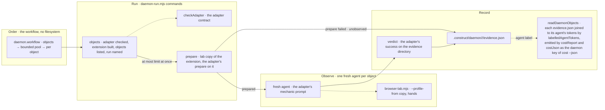

# construct daemon

The flow below is rendered from [composition/daemon.yaml](composition/daemon.yaml). Edit the model, then
run `pnpm composition:render`; `pnpm composition:check` fails when the diagram and the model drift
apart.

<!-- composition:daemon -->
`scripts/construct/daemon.workflow` is the composition root, and it only orders: every step that touches a file or runs an adapter command is a command of `scripts/construct/daemon-run.mjs`, run by a low-effort agent, because the Workflow sandbox allows no import and no filesystem. `objects` checks the adapter through `checkAdapter` of `daemon.mjs`, builds the extension and lists the objects, and names the run. The objects then go through a bounded pool, `limit` at once (2 when not given). Per object, `prepare` copies the extension to a lab copy and runs the adapter's prepare on it; a prepare that fails writes `evidence.json` as unobserved and starts no agent. Otherwise one fresh agent, labelled `daemon:<run>:<object>`, reads the adapter's mechanic prompt and observes through `browser-lab.mjs` on a `--profile-from` copy of the base profile, its hands through `browser-lab.mjs hands`, and leaves the lab outputs in the object's evidence directory. `verdict` runs the adapter's success there and writes `.construct/daemon/<run>/<object>/evidence.json`: the object, the verdict and its line, the lab outputs, the screenshot, the console and the agent's label. The object's cost is read afterwards: `readDaemonObjects` reads each object's `evidence.json` and joins its agent's transcript tokens through `labelledAgentTokens`, and `costReport` puts the result into the report that `costJson` emits as the `daemon` key of `cost --json`.

<!-- /composition:daemon -->
