# construct detach

The flow below is rendered from [composition/detach.yaml](composition/detach.yaml). Edit the model,
then run `pnpm composition:render`; `pnpm composition:check` fails when the diagram and the model
drift apart.

<!-- composition:detach -->
`askDetach(ui, options, prompter)` in `src/commands/detach/index.ts` is the composition root: it runs plan → preview → confirm or `--yes` → apply. `planDetach` does every read — the record, the exclude block, the git index, the class of each recorded file, the kept copy of the settings file (path confined, sha256 checked) and the classification of the runtime files — before any write, and each refusal leaves the tree as it found it. The preview lists what goes, each daemon run directory, the factory's directory beside the repository with its handoff, archive and decisions, and the Engram, with its number of paths and the total; then a confirmation, or `--yes`, and without either nothing is removed and detach exits as aborted. Only then the factory beside the repository, the guard entry (restored from the copy or cut), the files, their emptied directories, the runtime files, the run directories, `.construct/browser`, the copy, the exclude block and the record are removed in that order. Dotted edges are wiring, solid edges are the flow.

```mermaid
flowchart LR
  subgraph b_entry["Entry"]
    cli["construct detach (citty, alias jack-out)"]
    ask["askDetach"]
  end
  subgraph b_read["Read · before any write"]
    run["planDetach"]
    record["readAttachRecord"]
    exclude["pathsInExcludeBlock, removeExcludeBlock"]
    indexreader["readTrackedPaths · .git/index, .git/config"]
    copy["pre-image: path confined, sha256 checked; mismatch → refused"]
  end
  subgraph b_classify["Classify"]
    classify["adopted → absent → changed → remove"]
    settings["guard entry: adopted → absent → changed → remove"]
    runtime["runtime files: on the list, untracked, not held at attach"]
    runtimelist["ATTACH_RUNTIME_FILES"]
  end
  subgraph b_confirm["Preview and confirm"]
    preview["previewDetach: run directories, the factory beside, the Engram, each with its paths, and the total"]
    confirm["confirm or --yes; declined or no terminal → aborted, nothing removed"]
  end
  subgraph b_remove["Remove"]
    restore["guard entry out: the copy's bytes when the file is as attach left it, else cut"]
    remove["files by sha, empty directories, runtime files, run directories, .construct/browser, exclude block, record"]
    strategies["removeBlock"]
    directories["removeEmptyDirectories"]
    original["drop the copy, its key directory, the attach directory when empty"]
  end
  cli -->|"prompter when a terminal"| ask
  ask -->|"plan"| run
  run --> record
  run -.->|"block paths"| exclude
  run -->|"record found; unreadable index → refused"| indexreader
  indexreader -->|"tracked set"| classify
  classify -->|"then the guard entry"| settings
  settings -->|"then the kept copy"| copy
  copy -->|"then the runtime files"| runtime
  runtime -->|"nothing changed"| preview
  preview --> confirm
  confirm -->|"apply; entry out first"| restore
  restore --> remove
  indexreader -.->|"tracked set"| settings
  indexreader -.->|"tracked set"| runtime
  runtime -.-> runtimelist
  remove -.-> directories
  remove -->|"after .construct/browser, before the exclude block"| original
  remove -.-> exclude
  exclude -.-> strategies
```

<!-- /composition:detach -->

## Where the boundaries are

Read happens in full before a byte is written: the record, the paths in the exclude block, the tracked
set from `.git/index`, and the class of every recorded file. Each refusal — a block without a record,
an index this reader cannot parse, a carrier whose bytes changed — returns from inside Read and leaves
the tree exactly as it found it. Classify names four classes in one fixed order, adopted first, so a
carrier git tracks is the owner's whatever its bytes. The guard entry in `.claude/settings.local.json` is classed after the
files and taken out before them. Remove takes the files, then the recorded
directories that emptied, then the block attach added to `.git/info/exclude`, then the record; a file
the record does not list is never deleted and is named in the report, except the closed list
`ATTACH_RUNTIME_FILES`, and only when untracked and not held at attach; `.construct/` itself goes only
when attach created it and it is empty.
