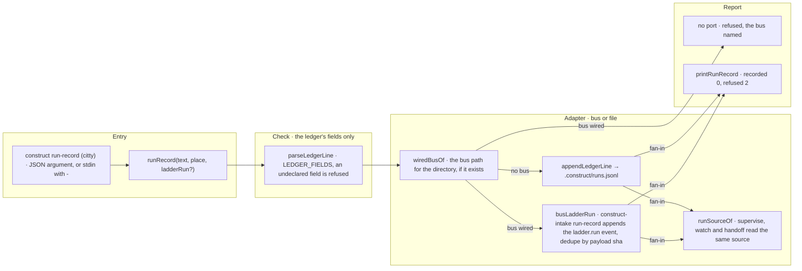

# The run record: fields of one row per ladder run

Status: a description only. No code writes or reads this record yet. Measured and written as item 2.4
of the first wave, from the observation *Pre-registered predictions across an attach and detach pair*
in [observations.md](observations.md). The journal file first named as the source does not exist; that
entry is the journal.

## Where it lives

`.construct/run-records.jsonl`, one JSON line per ladder run. It is local working state, like the
ledger `.construct/runs.jsonl`, and it is outside the public contract of
[0030](decisions/0030-public-contract.md). When it is implemented, it joins `OUTSIDE_THE_CONTRACT` in
`scripts/contract/surface.ts` next to the ledger.

## One row per run

A row belongs to exactly one ladder run. A prediction that is carried into a later run is **repeated
in that run's row with the same `id` and its original `writtenAt`**. It is never moved, and never
re-dated to the run that finally checked it. So the time a prediction was written stays readable from
every run that checked it.

## Fields

| Field | What it holds | Rule |
|---|---|---|
| `run` | the Workflow run id | the key into the ledger; never invented, as in the ledger |
| `pr` | the pull request the run's work landed in | the attach PR's predictions were recorded only in its session, because its description carried another PR's text; the row is where they stay together |
| `headSha` | the head the predictions were checked at | the sha named in "ready at sha X" |
| `predictions[]` | one entry per prediction, fields below | written before the run |
| `labels[]` | one entry per prediction, fields below | written after the run, never rewritten |
| `replacedCriteria[]` | brief criteria found false and replaced aloud, fields below | — |

**Cost is not a field.** Tokens, agents, tool uses and seconds are joined from the ledger by `run` when
the row is read, so the same figure never lives in two places. Only work outside the ladder, such as a
review session, would need its own figure. That figure is then recorded with what produced it.

### `predictions[]`

| Field | What it holds |
|---|---|
| `id` | a stable identifier, e.g. `P3`; kept when the prediction is carried into another run |
| `wrongImplementation` | the named wrong implementation, as in 0029 |
| `expectedRed` | the assertion expected to turn red (file and full test name), or `green`, or `lint` |
| `writtenAt` | when the prediction was written; must be earlier than the start of the first run that checks it, which is checkable against the runtime's record of that run |
| `writtenBy` | a role (owner, reviewer, planning session, implementer), not a person |

A prediction with two independent parts is **two predictions**. The journal's "confirmed, by half" (P3:
the target-set assertion red, the create-only assertion not) is written as two ids, each with its own
label.

### `labels[]`

| Field | What it holds |
|---|---|
| `predictionId` | the prediction it labels |
| `label` | a closed set: `confirmed`, `refuted`, `not checked`; there is no `partial` |
| `observedRed` | every assertion that actually turned red, **including reds nobody predicted** (the journal's P5: a race test outside the predicted acceptance also turned red) |
| `mechanism` | `run` or `review`: what produced the label |
| `evidence` | where the reading can be found: a `mutate judge --json` output, a PR description line, a CI job; required for `mechanism: review`, because P6 was labelled confirmed by review with the comparison in neither PR |
| `labelledBy` | a role |
| `labelledAt` | when the label was written |

Where the prediction was run through `construct mutate`, the label comes from `mutate judge --json`
(`outcome`, `failures`). That output is the only witness that survives, because `mutate` deletes its own
record after a successful restore.

### `replacedCriteria[]`

| Field | What it holds |
|---|---|
| `criterion` | the text as it was written |
| `writtenBy` | a role |
| `foundFalseBy` | a premise check, the implementer inside a run, or review |
| `when` | `before the run` or `inside the run` |

The journal recorded five such criteria, each from whoever wrote the brief. This field is what keeps
that pattern countable instead of anecdotal.

## Writing a ladder run

The ledger line a ladder run writes today is recorded by one command, `construct run-record`, which
picks the adapter itself: a `.construct/runs.jsonl` line where no bus is wired, and where one is a
`ladder.run` event through the port the factory bin `construct-intake run-record` wires in. The flow below is rendered from [composition/runRecord.yaml](composition/runRecord.yaml).
Edit the model, then run `pnpm composition:render`; `pnpm composition:check` fails when the diagram
and the model drift apart.

<!-- composition:runRecord -->
`runRecord(text, place, ladderRun?)` in `src/commands/run-record.ts` is the composition root of the one call step 4 of `/implement` makes, in the factory and in a generated repository alike. It parses the record with the ledger's own `parseLedgerLine` and refuses a line that does not parse or that names a field outside `LEDGER_FIELDS`, so nothing is written for a refused record. Then it picks the adapter, and the choice lives here, never in the skill: `wiredBusOf` resolves the bus path the factory would use for the directory. Where none exists the record is appended as one line to `.construct/runs.jsonl` through `appendLedgerLine`, the module that owns that file. Where one exists the published CLI does not write to it: the record goes, as one `ladder.run` event with its card from `CONSTRUCT_CARD` or the leading `#N` of the task and its dedupe key the sha of the payload, through the `ladderRun` port that the factory bin `construct-intake run-record` wires in (`busLadderRun` in `scripts/intake/intake.ts`), so a repeated call adds no second event; with no port the command refuses and names the bus. The readers follow the same choice: `runSourceOf` in `scripts/ladder/ledger.ts` reads the bus where one is wired and the tree's file where none is, so no reader stays on a file nobody writes. `printRunRecord` names the adapter and the target; a refusal exits 2.

<!-- /composition:runRecord -->
